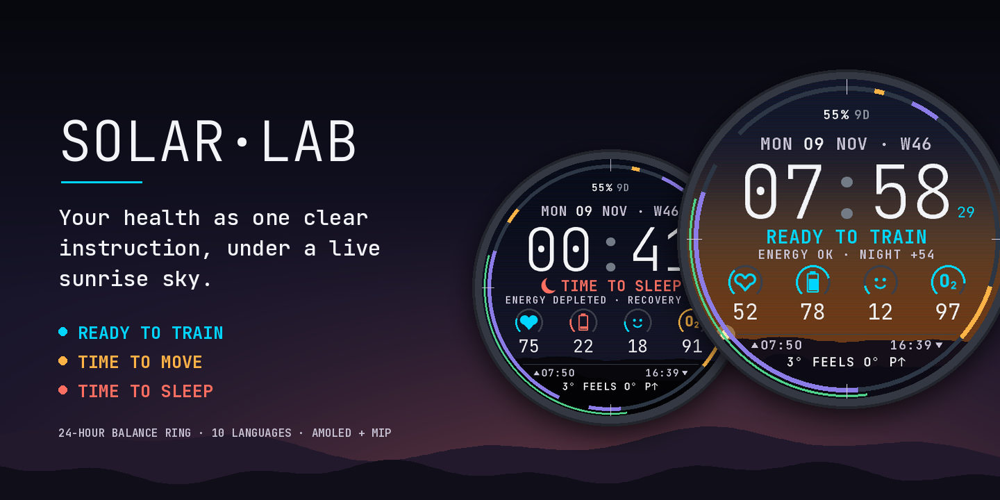
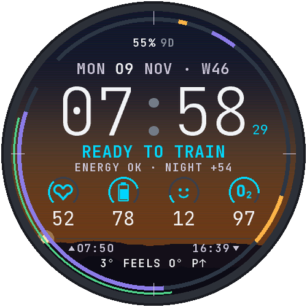
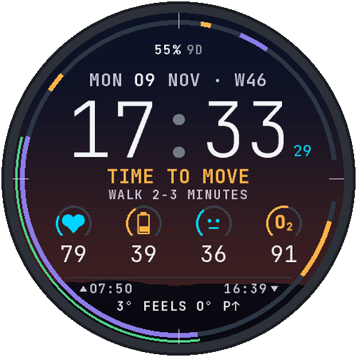
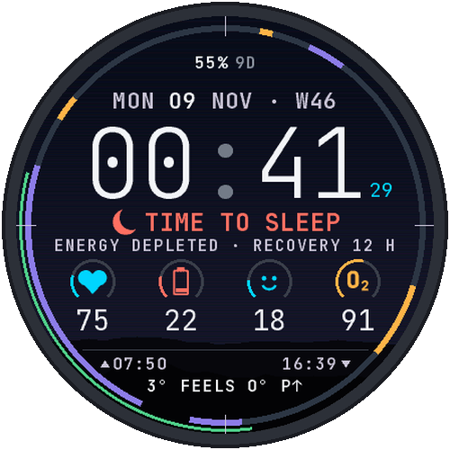
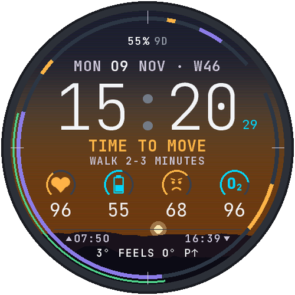
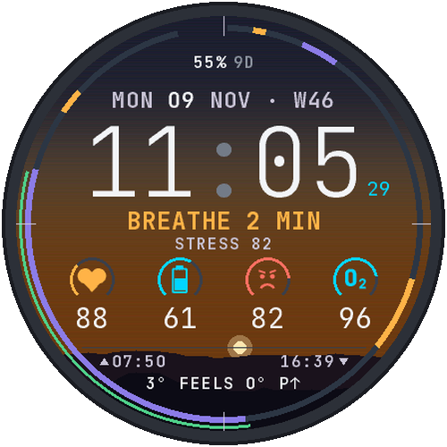
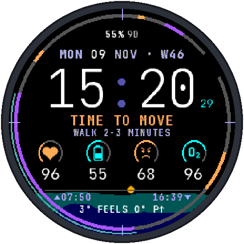

<p align="center">
  
</p>

# SOLAR·LAB

A Garmin Connect IQ watch face that turns your health data into one instruction: train, move, breathe or sleep. The background is a sunrise sky over mountains that follows the real position of the sun.

<p align="center">
  <a href="https://apps.garmin.com/apps/87435cd2-7d6c-4a2c-9e14-ed6be6df036e"><b>Get it in the Connect IQ Store</b></a>
  &nbsp;·&nbsp;
  <a href="https://github.com/mrBurma/solar-lab/releases/latest">Download .prg builds</a>
</p>

| Morning | Evening | Night |
|:---:|:---:|:---:|
|  |  |  |
| **Day** | **High stress** | **MIP screen (fenix 7)** |
|  |  |  |

## What it shows

**Command line.** One line under the time says what to do now, with the reason below it:

- `READY TO TRAIN`: energy is fine and the night recharge was good
- `TIME TO MOVE`: an hour without moving, walk for 2-3 minutes
- `BREATHE 2 MIN`: stress is high
- `LIGHT LOAD` / `REST DAY`: recovery is not complete
- `TIME TO SLEEP`: you are inside your sleep window

The advice is built from Body Battery, resting heart rate against your own two-week norm, last night's recharge, stress, blood oxygen and Garmin's recovery time.

**Four traffic-light gauges.** Heart rate, Body Battery, stress and blood oxygen (breathing rate when Pulse Ox is off). In the first three hours after waking the heart-rate gauge shows resting HR instead, to answer "did I recover?". Colour answers "is it OK?" (cyan is fine, amber means watch it, coral means act), the arc answers "how much?".

**24-hour balance ring.** Noon at the top, midnight at the bottom. Lavender marks time when Body Battery was charging, amber marks activity (zone 2 and above), slate is ordinary time, and a green arc shows the sleep window from your Garmin profile.

**Live sky.** Sky colour follows the solar elevation for your location. Sunrise and sunset, temperature, feels-like and barometric trend sit at the bottom.

**Touch and hold** a gauge to open the native Garmin widget for that metric, with HRV status, sleep score and full history graphs that a watch face cannot read.

**Also:** time with seconds, date and ISO week, battery in percent and days left, 10 languages that follow the watch language (EN, DE, FR, ES, IT, PT, NL, PL, UK, RU).

## Background alerts

Outside a recorded activity the face wakes a background process every 5 minutes (the Connect IQ minimum) and sends a system notification when:

| Alert | Condition |
|---|---|
| HR high | 10 min in zone 4+ with no activity running; the text tells climbing, moving or at rest apart |
| HR high at rest | 10 min at resting HR + 30 bpm (+25 at night) with almost no steps |
| HR low | 10 min at or below 38 bpm |
| SpO2 low | two readings at or below 85 % within 30 min |
| Stress | 30 min of stress at 76 or above during the day |
| Heat | air at 30 °C or above and 10 min in zone 3+ |

Each rule has a cooldown, so one situation produces one notification. Expect 5-10 minutes of latency: outside an activity the watch stores heart rate only every 1-2 minutes. Sleep mode and Do Not Disturb can silence a notification at night, so every event is also kept on the face for 12 hours.

## Power and display

- AMOLED: full face while the screen is on, a dim always-on mode with burn-in protection when it is off.
- MIP (fenix 7, Forerunner 255 and others): the full face stays on all the time, with fonts sized for 218-280 px screens.
- No phone app, no account, no network requests. Weather comes from the watch's own Garmin weather cache. Nothing leaves the watch.

## Supported devices

66 round watches released since the epix (Gen 2) that run Connect IQ 5.1 or newer:

- **epix:** epix (Gen 2), epix Pro (Gen 2) 42/47/51 mm
- **fēnix:** fēnix 7 / 7S / 7X and Pro variants, fēnix E, fēnix 8 (AMOLED and Solar), fēnix 9 and Pro variants
- **Forerunner:** 165, 170, 255, 265, 570, 955, 965, 970 (and their Music / S variants), Forerunner 70
- **Venu / vívoactive:** Venu 3 / 3S, Venu 4, vívoactive 5, vívoactive 6
- **Outdoor and specialist:** Enduro 3 / 4, Instinct 3 AMOLED, Instinct Crossover AMOLED, MARQ (Gen 2), MARQ Aviator, MARQ (Gen 3), D2 Mach 1 / Mach 2 / Mach 2 Pro, Descent G2, Descent Mk3, Approach S50 / S70 / S72

The exact list is in [`manifest.xml`](manifest.xml).

## Install

**From the Connect IQ Store (recommended).** Open the [store page](https://apps.garmin.com/apps/87435cd2-7d6c-4a2c-9e14-ed6be6df036e) on your phone or in Connect IQ on the phone and install. Store installs update automatically.

**Sideload a build.**

1. Download `SOLARLAB-v*-prg.zip` from [Releases](https://github.com/mrBurma/solar-lab/releases/latest) and take the file for your model, for example `SOLARLAB_epix2.prg` for an epix (Gen 2).
2. Connect the watch by USB. On macOS you need an MTP client such as [OpenMTP](https://openmtp.ganeshrvel.com/), since Finder does not mount Garmin watches.
3. Copy the `.prg` into `GARMIN/APPS/` on the watch and disconnect.
4. Pick SOLAR·LAB in the watch face list.

A sideloaded copy does not update itself. Remove it before installing from the store, otherwise you get two copies.

## Build from source

You need the [Connect IQ SDK](https://developer.garmin.com/connect-iq/sdk/) 9.3 or newer with the device files from SDK Manager, Java 11+, and your own developer key:

```bash
openssl genrsa -out developer_key.pem 4096
openssl pkcs8 -topk8 -inform PEM -outform DER -in developer_key.pem -out developer_key.der -nocrypt
```

Build for one device and run it in the simulator:

```bash
SDK="$HOME/Library/Application Support/Garmin/ConnectIQ/Sdks/<sdk-folder>/bin"
"$SDK/monkeyc" -f monkey.jungle -y /path/to/developer_key.der -d epix2 -r -o bin/SOLARLAB.prg
"$SDK/connectiq" &
"$SDK/monkeydo" bin/SOLARLAB.prg epix2
```

Package for all devices (the `.iq` file the store takes):

```bash
"$SDK/monkeyc" -e -f monkey.jungle -y /path/to/developer_key.der -r -o bin/SOLARLAB.iq
```

In VS Code the Monkey C extension does the same through `Monkey C: Build for Device` and `Monkey C: Export Project`.

## Project layout

```
source/
  SolarLabApp.mc         entry point, registers the background process
  SolarLabView.mc        watch face lifecycle: onUpdate, onEnterSleep / onExitSleep
  SolarLabDelegate.mc    touch and hold on a gauge opens the native Garmin widget
  background/
    Sentinel.mc          5-minute background checks and notifications
  domain/                data and decisions, no drawing
    HealthData.mc        reads sensors and history, marks missing or stale values
    Baseline.mc          personal norm: one record per day in Application.Storage
    Readiness.mc         recovery state from Body Battery, night recharge, RHR
    Advice.mc            picks the command line and its reason
    Status.mc            maps values to fine / watch / act
    SolarMath.mc         solar position, sunrise and sunset
    SolarState.mc        sky phase for the current time
    WeatherInfo.mc       weather cached by the watch, no network calls
    PowerManager.mc      high / low power state, burn-in shift
    Slots.mc             which four metrics to show for the time of day
    DateUtil.mc, Tr.mc   date format, localised strings
  render/                drawing only
    FaceRenderer.mc      full face
    AodRenderer.mc       always-on face
    SkyRenderer.mc       sunrise sky and mountains
    RingRenderer.mc      24-hour balance ring
    SlotRenderer.mc      gauges
    LayoutManager.mc     geometry designed at 416 px, scaled per screen
    Palette.mc           colours
resources/                default resources (English, 416 px fonts)
resources-round-WxH/      fonts per screen size
resources-<lang>/         translations
```

## Limitations

- Not a medical device. Readings come from the wrist sensor and are for general wellness only. Wrist SpO2 usually reads a few points below a fingertip oximeter.
- Body Battery, stress and SpO2 depend on what the watch model records. Missing values are shown as missing, never estimated.
- Background alerts work with a 5-10 minute delay and do not run during a recorded activity.

## Credits

- Sky colour model ported from the [GhostFX](https://github.com/r3dg0d/ghostfx) `sunrise.glsl` shader by r3dg0d, MIT License.
- Bitmap fonts generated from [JetBrains Mono](https://github.com/JetBrains/JetBrainsMono), SIL Open Font License 1.1.

Author: Dmitriy Ageev ([@mrBurma](https://github.com/mrBurma)).
